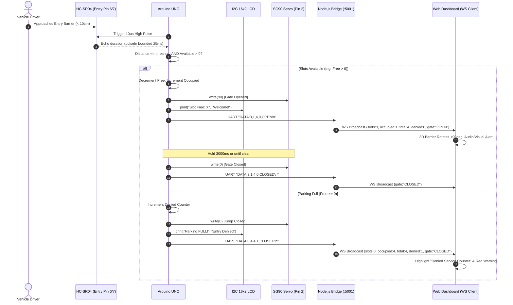

# Production Development Plan: Real-Time Smart Car Parking System (IoT + Full-Stack Web)

**Document Version:** 1.0.0  
**Architect:** Principal Embedded IoT Architect & Lead Full-Stack Engineer  
**Target Environment:** Arduino UNO R3 (ATmega328P) + Node.js Telemetry Bridge + Vite/React 3D Web Dashboard (Antigravity Orchestrated)  
**Date:** October 2026  

---

## 1. System Architecture & Data Flow

### 1.1 High-Level Architecture Overview
The system bridges physical embedded sensors and actuators with an interactive, modern web application. It operates in dual modes: **Physical Hardware Mode** (USB CDC Serial connection to Arduino UNO) and **Software Emulation Mode** (deterministic virtual state-machine simulation inside the bridge server).

```
 +-------------------------------------------------------------------------------+
 |                              PHYSICAL HARDWARE LAYER                          |
 |                                                                               |
 |   [Entry HC-SR04]      [Exit HC-SR04]      [16x2 I2C LCD]     [SG90 Servo]    |
 |    Trig: 6 Echo: 7      Trig: 8 Echo: 9      SDA:A4 SCL:A5       PWM Pin: 2   |
 |           \                   /                   ^                  ^        |
 |            \                 /                    |                  |        |
 |         +---------------------------------------------------------------+     |
 |         |                  Arduino UNO (ATmega328P)                     |     |
 |         |   - Non-blocking ultrasonic scan (25ms timeout)               |     |
 |         |   - State machine: IDLE -> DETECTED -> GATE_OPEN -> TIMEOUT  |     |
 |         |   - Telemetry output: 9600 Baud UART (CDC ACM / COMx)         |     |
 |         +---------------------------------------------------------------+     |
 +---------------------------------------|---------------------------------------+
                                         | USB Serial (9600 baud, 8N1)
                                         | Streams `DATA:S,O,T,D,G\n`
                                         v
 +-------------------------------------------------------------------------------+
 |                        LOCAL SERIAL / WEBSOCKET BRIDGE                        |
 |                                                                               |
 |   +------------------------+             +--------------------------------+   |
 |   | SerialPort / Readline  |             | Virtual Hardware Simulator     |   |
 |   | Parser ('\n')          |             | (Fallback Mock Generator)      |   |
 |   +------------------------+             +--------------------------------+   |
 |                \                                  /                           |
 |                 +----------------+---------------+                            |
 |                                  v                                            |
 |                   +-----------------------------+                             |
 |                   |  Bridge Controller & Cache  |                             |
 |                   |  - In-Memory State & Log    |                             |
 |                   |  - Telemetry Normalizer     |                             |
 |                   +-----------------------------+                             |
 |                             |                 ^                               |
 |                             v                 | Bidirectional JSON/RPC        |
 |                   +-----------------------------+                             |
 |                   |   Fastify / Express + WS    |                             |
 |                   |   Port 5001 / WebSocket     |                             |
 |                   +-----------------------------+                             |
 +-----------------------------------|-------------------------------------------+
                                     | WebSocket (`ws://localhost:5001`)
                                     | HTTP REST (`http://localhost:5001/api`)
                                     v
 +-------------------------------------------------------------------------------+
 |                         CLIENT APPLICATION LAYER                              |
 |                                                                               |
 |   +------------------------------------+  +-------------------------------+   |
 |   | 3D Public Landing Showcase         |  | Secure Admin Analytics Portal |   |
 |   | - Three.js / React Three Fiber     |  | - JWT / Session Protected     |   |
 |   | - Low-poly Barrier & Parking Bay   |  | - Real-Time Gauge & Badges    |   |
 |   | - Interactive Camera & Lights      |  | - Recharts / ECharts Analytics|   |
 |   | - Live Gate Mechanical Animation   |  | - Capacity Optimization Index |   |
 |   | - BOM & Hardware Pinout Visualizer |  | - Emergency Hardware Override |   |
 |   +------------------------------------+  +-------------------------------+   |
 +-------------------------------------------------------------------------------+
```

### 1.2 Data Flow Sequences

#### Sequence A: Vehicle Entry Flow (Physical & Virtual Sync)


#### Sequence B: Manual Cloud Override Flow (Operator to Hardware)
```mermaid
sequenceDiagram
    autonumber
    actor Admin as Facility Administrator
    participant Dashboard as Admin UI (React)
    participant Bridge as Node.js Bridge (:5001)
    participant MCU as Arduino UNO
    participant Servo as SG90 Servo (Pin 2)

    Admin->>Dashboard: Clicks "Emergency Gate Open"
    Dashboard->>Bridge: WS Send `{"action":"COMMAND","command":"CMD:OPEN_GATE"}`
    Bridge->>Bridge: Verify Admin JWT / Session Role
    Bridge->>MCU: Serial Write "CMD:OPEN_GATE\n"
    MCU->>Servo: write(90)
    MCU->>MCU: Force Gate State = MANUAL_OPEN
    MCU->>Bridge: UART "ACK:CMD:OPEN_GATE;STATE:MANUAL_OPEN\n"
    Bridge->>Dashboard: WS Broadcast {status:"OK", gateState:"MANUAL_OPEN"}
```

---

## 2. Hardware Pinout Reference & Firmware Specification

### 2.1 Complete Pinout & Wiring Table
Strict physical layout matching the reference system without any modification to pin allocations:

| Component | Pin / Terminal | Arduino UNO Pin | Signal Type | Electrical Specification | Description / Function |
| :--- | :--- | :--- | :--- | :--- | :--- |
| **SG90 Micro Servo** | Orange / Yellow (PWM) | **Pin 2** | Digital PWM / Timer | 50Hz, 1.0ms–2.0ms duty cycle | Barrier arm lift actuator |
| | Red (VCC) | **5V Rail** | DC Power (+5V) | Peak draw ~500mA (Decoupled) | Motor positive supply |
| | Brown / Black (GND) | **GND** | Ground | Return path | System Common Ground |
| **HC-SR04 #1 (Entry)** | VCC | **5V Rail** | DC Power (+5V) | Active ~15mA | Ultrasonic sensor supply |
| | Trig | **Pin 6** | Digital Output | 10µs TTL Active HIGH | Ultrasonic burst trigger |
| | Echo | **Pin 7** | Digital Input | 5V TTL return pulse | Echo duration proportional to distance |
| | GND | **GND** | Ground | Return path | System Common Ground |
| **HC-SR04 #2 (Exit)** | VCC | **5V Rail** | DC Power (+5V) | Active ~15mA | Ultrasonic sensor supply |
| | Trig | **Pin 8** | Digital Output | 10µs TTL Active HIGH | Ultrasonic burst trigger |
| | Echo | **Pin 9** | Digital Input | 5V TTL return pulse | Echo duration proportional to distance |
| | GND | **GND** | Ground | Return path | System Common Ground |
| **16x2 LCD w/ I2C (PCF8574)** | VCC | **5V Rail** | DC Power (+5V) | Active ~20mA (Backlit) | Display controller power |
| | GND | **GND** | Ground | Return path | System Common Ground |
| | SDA | **A4** (PC4) | I2C Data | 100kHz I2C Bus with pullups | Display serial data bus |
| | SCL | **A5** (PC5) | I2C Clock | 100kHz I2C Bus with pullups | Display serial clock bus |
| **Power Decoupling** | 100µF–470µF Electrolytic | Across 5V and GND | Analog Filtering | Low-ESR, rated >= 10V | Eliminates servo inrush brownouts |

> [!IMPORTANT]
> **Power Rail Integrity:** SG90 servo motor inrush currents during rapid movement can drop the ATmega328P VCC below the Brown-Out Detection (BOD) threshold (2.7V/4.3V), triggering continuous hardware MCU resets. A **100µF to 470µF electrolytic capacitor** must be placed directly across the 5V and GND rails near the servo leads.

---

### 2.2 Firmware Architecture & Fixes

#### Critical Defect Remediation: `pulseIn()` Timeout Bug
Standard `pulseIn(echoPin, HIGH)` has a default blocking timeout of **1,000,000 microseconds (1 second)**. If an ultrasonic burst fails to reflect or an echo is lost, execution freezes for a full second per sensor. When timed out, `pulseIn()` returns `0`, causing flawed distance math (`0 * 0.034 / 2 = 0cm`), falsely triggering `distance < 10cm` and erroneously opening the gate or corrupting inventory counts.

**Remediation Logic:**
1. Supply a strict timeout parameter: `pulseIn(echoPin, HIGH, 25000)` (25ms equates to max ~4.2 meters range).
2. Explicitly validate distance: Reject readings of `0` or negative values before treating them as proximity detections.

```cpp
// Corrected safe distance calculation function
long getDistanceSafe(uint8_t trigPin, uint8_t echoPin) {
  digitalWrite(trigPin, LOW);
  delayMicroseconds(2);
  digitalWrite(trigPin, HIGH);
  delayMicroseconds(10);
  digitalWrite(trigPin, LOW);

  // 25,000 microseconds timeout prevents 1-second system stall
  unsigned long duration = pulseIn(echoPin, HIGH, 25000UL);
  
  if (duration == 0) {
    return 999; // Return out-of-range sentinel value (No echo detected)
  }
  
  long distanceCm = duration * 0.034 / 2;
  return (distanceCm <= 0) ? 999 : distanceCm;
}
```

#### Production-Ready Firmware (`firmware/smart_parking.ino`)
Key features:
- Non-blocking state management via `millis()`.
- State debounce logic preventing jitter and double-counting.
- Serial protocol parser for incoming supervisor commands (`CMD:OPEN_GATE`, `CMD:RESET_STATS`).
- Standardized periodic telemetry packet: `DATA:<FREE>,<OCCUPIED>,<TOTAL>,<DENIED>,<GATE_STATE>\n`.

```cpp
/**
 * Smart Car Parking System - Production Firmware
 * Board: Arduino UNO R3 (ATmega328P)
 * Wiring: Pin 2 (Servo), Pin 6/7 (Entry HC-SR04), Pin 8/9 (Exit HC-SR04), A4/A5 (I2C LCD)
 */

#include <Wire.h>
#include <LiquidCrystal_I2C.h>
#include <Servo.h>

// Hardware Pin Definitions
const uint8_t SERVO_PIN      = 2;
const uint8_t ENTRY_TRIG_PIN = 6;
const uint8_t ENTRY_ECHO_PIN = 7;
const uint8_t EXIT_TRIG_PIN  = 8;
const uint8_t EXIT_ECHO_PIN  = 9;

// Parameters & Thresholds
const uint8_t TOTAL_CAPACITY = 4;
const long    DETECTION_THRESHOLD_CM = 10;
const unsigned long GATE_HOLD_TIME_MS = 3000;
const unsigned long TELEMETRY_INTERVAL_MS = 500;
const unsigned long SENSOR_SAMPLE_INTERVAL_MS = 60;

// LCD & Servo Instances
LiquidCrystal_I2C lcd(0x27, 16, 2); // Fallback to 0x3F if 0x27 unacknowledged
Servo barrierServo;

// System State Variables
int availableSlots = TOTAL_CAPACITY;
int occupiedSlots  = 0;
unsigned long deniedEntries = 0;

enum GateState {
  GATE_CLOSED,
  GATE_OPENING,
  GATE_OPEN,
  GATE_CLOSING,
  GATE_MANUAL_HOLD
};

GateState currentGateState = GATE_CLOSED;
unsigned long gateOpenTimestamp = 0;
unsigned long lastTelemetryTimestamp = 0;
unsigned long lastSensorSampleTimestamp = 0;

bool entrySensorActive = false;
bool exitSensorActive = false;

// Function Prototypes
long getDistanceSafe(uint8_t trigPin, uint8_t echoPin);
void handleSerialCommands();
void broadcastTelemetry();
void updateLcdDisplay();
void setGate(bool open);

void setup() {
  Serial.begin(9600);
  
  pinMode(ENTRY_TRIG_PIN, OUTPUT);
  pinMode(ENTRY_ECHO_PIN, INPUT);
  pinMode(EXIT_TRIG_PIN, OUTPUT);
  pinMode(EXIT_ECHO_PIN, INPUT);
  
  barrierServo.attach(SERVO_PIN);
  barrierServo.write(0); // 0 degrees = Barrier Horizontal / Closed
  
  lcd.init();
  lcd.backlight();
  lcd.setCursor(0, 0);
  lcd.print("Smart Parking OS");
  lcd.setCursor(0, 1);
  lcd.print("Initializing...");
  delay(1200);
  
  updateLcdDisplay();
  broadcastTelemetry();
}

void loop() {
  unsigned long now = millis();

  // 1. Process incoming Serial command packets
  handleSerialCommands();

  // 2. Sample Sensors at fixed non-blocking interval
  if (now - lastSensorSampleTimestamp >= SENSOR_SAMPLE_INTERVAL_MS) {
    lastSensorSampleTimestamp = now;

    long entryDist = getDistanceSafe(ENTRY_TRIG_PIN, ENTRY_ECHO_PIN);
    long exitDist  = getDistanceSafe(EXIT_TRIG_PIN, EXIT_ECHO_PIN);

    // Entry Sequential Detection Logic
    if (entryDist > 0 && entryDist <= DETECTION_THRESHOLD_CM) {
      if (!entrySensorActive && currentGateState != GATE_MANUAL_HOLD) {
        entrySensorActive = true;
        if (availableSlots > 0) {
          availableSlots--;
          occupiedSlots++;
          setGate(true);
          updateLcdDisplay();
          broadcastTelemetry();
        } else {
          deniedEntries++;
          lcd.clear();
          lcd.setCursor(0, 0);
          lcd.print("PARKING FULL!");
          lcd.setCursor(0, 1);
          lcd.print("Entry Refused");
          broadcastTelemetry();
          delay(1000);
          updateLcdDisplay();
        }
      }
    } else {
      entrySensorActive = false;
    }

    // Exit Sequential Detection Logic
    if (exitDist > 0 && exitDist <= DETECTION_THRESHOLD_CM) {
      if (!exitSensorActive && currentGateState != GATE_MANUAL_HOLD) {
        exitSensorActive = true;
        if (occupiedSlots > 0) {
          occupiedSlots--;
          availableSlots++;
          setGate(true);
          updateLcdDisplay();
          broadcastTelemetry();
        }
      }
    } else {
      exitSensorActive = false;
    }
  }

  // 3. Automated Gate Timeout Closer
  if (currentGateState == GATE_OPEN && (now - gateOpenTimestamp >= GATE_HOLD_TIME_MS)) {
    setGate(false);
    updateLcdDisplay();
    broadcastTelemetry();
  }

  // 4. Heartbeat Telemetry Broadcast
  if (now - lastTelemetryTimestamp >= TELEMETRY_INTERVAL_MS) {
    lastTelemetryTimestamp = now;
    broadcastTelemetry();
  }
}

long getDistanceSafe(uint8_t trigPin, uint8_t echoPin) {
  digitalWrite(trigPin, LOW);
  delayMicroseconds(2);
  digitalWrite(trigPin, HIGH);
  delayMicroseconds(10);
  digitalWrite(trigPin, LOW);

  unsigned long duration = pulseIn(echoPin, HIGH, 25000UL); // 25ms timeout
  if (duration == 0) return 999;
  long dist = duration * 0.034 / 2;
  return (dist <= 0) ? 999 : dist;
}

void setGate(bool open) {
  if (open) {
    barrierServo.write(90); // 90 deg = Raised
    currentGateState = GATE_OPEN;
    gateOpenTimestamp = millis();
  } else {
    barrierServo.write(0);  // 0 deg = Lowered
    currentGateState = GATE_CLOSED;
  }
}

void updateLcdDisplay() {
  lcd.clear();
  lcd.setCursor(0, 0);
  lcd.print("HAVE LOT: ");
  lcd.print(availableSlots);
  lcd.print("/");
  lcd.print(TOTAL_CAPACITY);
  
  lcd.setCursor(0, 1);
  if (availableSlots == 0) {
    lcd.print("STATUS: FULL");
  } else {
    lcd.print("WELCOME TO PARK");
  }
}

void broadcastTelemetry() {
  const char* gateStr = (currentGateState == GATE_OPEN) ? "OPEN" : 
                        (currentGateState == GATE_MANUAL_HOLD) ? "MANUAL_HOLD" : "CLOSED";
  Serial.print("DATA:");
  Serial.print(availableSlots);
  Serial.print(",");
  Serial.print(occupiedSlots);
  Serial.print(",");
  Serial.print(TOTAL_CAPACITY);
  Serial.print(",");
  Serial.print(deniedEntries);
  Serial.print(",");
  Serial.println(gateStr);
}

void handleSerialCommands() {
  while (Serial.available() > 0) {
    String cmd = Serial.readStringUntil('\n');
    cmd.trim();
    if (cmd == "CMD:OPEN_GATE") {
      setGate(true);
      currentGateState = GATE_MANUAL_HOLD;
      broadcastTelemetry();
    } else if (cmd == "CMD:CLOSE_GATE") {
      setGate(false);
      broadcastTelemetry();
    } else if (cmd == "CMD:RESET_STATS") {
      availableSlots = TOTAL_CAPACITY;
      occupiedSlots = 0;
      deniedEntries = 0;
      setGate(false);
      updateLcdDisplay();
      broadcastTelemetry();
    }
  }
}
```

---

## 3. Backend Serial & WebSocket Bridge Specification

### 3.1 Node.js Bridge Server Architecture
The bridge (`server/bridge.js`) acts as the multiplexer between hardware USB ports and browser clients.

```
 [Arduino Serial USB] <---> [SerialPort Parser] <-\
                                                   +-> [State Manager & DB Log] <---> [WebSocket Server :5001]
 [Virtual Mock Generator] ------------------------/                                         ^
                                                                                            |
                                                                             [Web Client Subscribers]
```

### 3.2 Bridge Features & Capabilities
1. **Auto-Discovery & Auto-Reconnection:** Scans connected USB devices for `vendorId: "2341"` (Arduino LLC) or matching Silicon Labs / CH340 / FTDI drivers. If disconnected, automatically attempts reconnect every 3000ms.
2. **Software Simulation Toggle (Mock Mode):**
   - Configurable via `.env` (`MOCK_MODE=true` or automatically enabled if no USB COM port is found).
   - Generates deterministic simulated vehicular traffic:
     - Random entry arrivals following a Poisson distribution.
     - Simulated cars staying for 10–30 seconds.
     - Denied attempts when occupied = 4.
     - Instant response to manual gate open/close commands.
3. **Data Protocol Normalization:**
   - Parses inbound `DATA:SLOTS,OCCUPIED,TOTAL,DENIED,GATE_STATE`.
   - Emits structured JSON events over WebSocket:
     ```json
     {
       "type": "TELEMETRY",
       "timestamp": "2026-10-06T17:02:44.120Z",
       "data": {
         "availableSlots": 3,
         "occupiedSlots": 1,
         "totalCapacity": 4,
         "deniedCount": 0,
         "gateState": "CLOSED",
         "mode": "HARDWARE",
         "rssiMetrics": { "baudRate": 9600, "packetsPerSec": 2.0 }
       }
     }
     ```
4. **Command Relay Endpoint:**
   - Inbound WebSocket messages `{"action": "COMMAND", "command": "CMD:OPEN_GATE"}` are sanitized and piped directly to `serialPort.write("CMD:OPEN_GATE\n")`.

---

## 4. Frontend Architecture (3D Landing Page + Admin Portal)

### 4.1 Tech Stack & Design System
- **Framework:** React 19 / Vite (or Next.js 15 App Router).
- **Styling:** Tailwind CSS with CSS Variables for seamless Dark/Light Mode.
- **3D Visualization:** Three.js + `@react-three/fiber` + `@react-three/drei`.
- **Charts & Dashboards:** `recharts` / `lucide-react` for responsive metrics and hardware telemetry.
- **State Management:** Zustand for real-time WebSocket state distribution.

### 4.2 Web Application Information Architecture

```
/ (Root)
│
├── / (Landing Page: 3D Interactive Showcase)
│   ├── Hero Section: Title, System Status, Quick Stats Badge
│   ├── 3D Viewport:
│   │   ├── Interactive 3D Low-Poly Parking Lot & Barrier Gate
│   │   ├── OrbitControls (Pan, Zoom, Rotate with limits)
│   │   ├── Live Animated Barrier Arm (syncs with live gate state)
│   │   ├── 4 Parking Bays (Occupied spaces show parked 3D low-poly vehicle)
│   │   └── Interactive Hotspots: Click sensor to inspect pinout & specs
│   ├── Working Mechanism Walkthrough (Dual HC-SR04 detection pipeline)
│   ├── Engineering Benefits (Throughput, zero human intervention, carbon footprint)
│   └── Interactive Circuit & BOM Explorer (Arduino, SG90, HC-SR04 x2, I2C LCD)
│
├── /admin/login (Secure Authentication)
│   ├── Brute-force protected credentials input
│   └── JWT token generation & local cookie/storage persistence
│
└── /admin/dashboard (Secure Real-Time Management Console)
    ├── Top Navigation: Connection Status Badge (Hardware/Simulation), Port Info
    ├── Metric Cards:
    │   ├── Total Bays (4)
    │   ├── Available Capacity (Color-coded: Green > 1, Amber = 1, Red = 0)
    │   ├── Occupied Bays
    │   ├── Denied Service Counter (Refusal count with pulse warning)
    │   └── Barrier Physical State (OPEN / CLOSED / MANUAL_HOLD)
    ├── Operational Action Bar:
    │   ├── Emergency Manual Gate Toggle (Override hardware)
    │   └── Reset Telemetry Counters button
    ├── Analytics Section:
    │   ├── Real-time Occupancy Timeline (Area chart)
    │   ├── Hourly Inflow vs. Outflow (Bar chart)
    │   └── Peak-Time Turn-Away Frequency (Line chart)
    └── Predictive Optimization Engine:
        ├── Slot Expansion Viability Index (SEVI) Metric Display
        └── Capacity Recommendation Recommendation Advisor
```

### 4.3 3D Canvas Scene Specification (`react-three/fiber`)
- **Lighting:** Ambient light (0.6 intensity) + Directional sunlight with soft contact shadows.
- **Ground / Asphalt:** Dark textured plane with white parking bay divider striping.
- **Barrier Pillar & Boom Gate:**
  - Steel housing pillar (yellow/black safety stripes).
  - Rotational joint on Pin 2 logic: `pivotRef.current.rotation.z = MathUtils.lerp(pivotRef.current.rotation.z, targetAngle, 0.1)`.
  - When `gateState === 'OPEN'`, `targetAngle = Math.PI / 2` (90° raised).
- **Dynamic Vehicle Placement:**
  - 4 parking bays located at relative coordinates `[-3, 0, -2]`, `[-1, 0, -2]`, `[1, 0, -2]`, `[3, 0, -2]`.
  - As `occupiedSlots` changes, 3D low-poly car meshes smoothly animate into/out of available bays.

---

## 5. Mathematical Formulas for Capacity Recommendation & Denial Metrics

### 5.1 Denial Rate ($P_{\text{denied}}$)
The empirical probability of service denial (turn-away rate) over evaluation window $T$:
$$P_{\text{denied}} = \frac{N_{\text{denied}}}{N_{\text{entry\_attempts}}} = \frac{N_{\text{denied}}}{N_{\text{entered}} + N_{\text{denied}}}$$

Where:
- $N_{\text{denied}}$ = Total vehicles arriving while $S_{\text{available}} = 0$.
- $N_{\text{entered}}$ = Total admitted vehicles.

---

### 5.2 Slot Expansion Viability Index (SEVI)
The SEVI score ($0.0 \le \text{SEVI} \le 10.0$) computes the economic and structural urgency for adding parking bays:

$$\text{SEVI} = 10 \times \left[ w_1 \left( \frac{N_{\text{denied}}}{N_{\text{denied}} + N_{\text{entered}}} \right) + w_2 \left( \frac{T_{\text{full}}}{T_{\text{operating}}} \right) + w_3 \left( \frac{\bar{Q}_{\text{peak}}}{C_{\text{total}}} \right) \right]$$

**Recommended Weights:**
- $w_1 = 0.50$ (Weight of denied request ratio)
- $w_2 = 0.35$ (Weight of total time spent in 100% saturation state $T_{\text{full}}$)
- $w_3 = 0.15$ (Ratio of peak queue pressure to total capacity $C_{\text{total}} = 4$)

**Action Tiers:**
- $\text{SEVI} < 3.0$: **Nominal Operation.** Existing capacity matches demand.
- $3.0 \le \text{SEVI} < 6.5$: **Moderate Saturation.** Peak congestion mitigation advised (variable pricing, reservation slots).
- $\text{SEVI} \ge 6.5$: **Critical Bottleneck.** Physical slot expansion mandatory.

---

### 5.3 Capacity Expansion Recommendation ($C^*$)
To reduce the denial rate below the target threshold $\alpha = 0.05$ (5%), the engine models the lot as an $M/M/c/c$ Erlang Loss System (or empirical arrival-density scaling):

$$B(c, a) = \frac{\frac{a^c}{c!}}{\sum_{k=0}^{c} \frac{a^k}{k!}} \le \alpha$$

Where:
- $a = \lambda \cdot \frac{1}{\mu}$ (Offered traffic intensity in Erlangs)
- $\lambda$ = Average vehicle arrival rate (vehicles/hour)
- $\frac{1}{\mu}$ = Average parking duration (hours)
- $c$ = Number of total bays

**Empirical Linearized Expansion Formula:**
For quick frontend evaluation using streamed metrics:
$$\Delta C_{\text{recommended}} = \left\lceil \frac{N_{\text{denied}}}{T_{\text{peak\_hours}} \times \mu} \times \left(1 - \alpha\right) \right\rceil$$

Where the dashboard outputs:
> *"Current Capacity: 4 slots. Recommendation: Add $\Delta C$ slots (Target Total: $4 + \Delta C$) to drive peak denial rate from $X\%$ down to $< 5.0\%$."*

---

## 6. Step-by-Step Implementation Roadmap

```
Phase 1: Hardware & Firmware Assembly
   ├── Pinout verification (Servo on 2, HC-SR04 #1 on 6/7, HC-SR04 #2 on 8/9, LCD on A4/A5)
   ├── Capacitor installation (100uF across 5V/GND)
   └── Firmware upload (smart_parking.ino with 25ms pulseIn timeout)

Phase 2: Serial & WebSocket Bridge Backend
   ├── Project init (Node.js, ws, serialport, express/fastify, cors, dotenv)
   ├── Serial parser & auto-reconnect engine
   ├── Software Simulation / Mock Mode fallback implementation
   └── Bidirectional RPC routes (telemetry broadcast & command execution)

Phase 3: Public 3D Interactive Showcase
   ├── React + Vite + Tailwind CSS initialization
   ├── React Three Fiber scene setup (Canvas, Lighting, Camera, OrbitControls)
   ├── 3D Parking Lot + Animated SG90 Barrier Arm mesh integration
   └── Educational showcase content (BOM, interactive pinout, dual-sensor logic)

Phase 4: Secure Admin Portal & Telemetry Hub
   ├── Auth module (JWT login, protected route wrapper)
   ├── Zustand real-time store for WebSocket streaming
   ├── KPI Cards (Available, Occupied, Total, Denied, Gate State)
   └── Emergency hardware override control panel

Phase 5: Analytics & Predictive Capacity Engine
   ├── Recharts integration (Occupancy history, hourly traffic, denied rate)
   ├── SEVI mathematical calculation module
   └── Automated capacity expansion recommendation banner

Phase 6: End-to-End Testing & Dual-Process Orchestration
   ├── Antigravity background tasks setup (concurrent bridge + frontend)
   ├── Disconnect/reconnect stress tests
   └── Production build verification & documentation sign-off
```

### Detailed Phase Specifications

#### Phase 1: Hardware Assembly & Firmware Hardening
1. Wire components on breadboard according to Section 2.1.
2. Confirm 16x2 LCD I2C address using an I2C scanner sketch (`0x27` default, or `0x3F`).
3. Compile and upload `firmware/smart_parking.ino`.
4. Validate Serial Monitor output at 9600 baud:
   - Output string matches `DATA:4,0,4,0,CLOSED`.
   - Hand within 10cm of Sensor 1 updates: `DATA:3,1,4,0,OPEN`.
   - Verify gate returns to `CLOSED` after 3000ms.

#### Phase 2: Node.js Serial-WebSocket Bridge
1. Scaffold `server/` directory with `package.json`.
2. Implement `server/bridge.js` utilizing `serialport` and `ws`.
3. Build the Virtual Mock Mode fallback:
   - Detects when COM port is unavailable and switches seamlessly to `MOCK_MODE=true`.
   - Broadcasts mock telemetry on WebSocket port `5001`.
4. Expose HTTP REST endpoints for health check (`/api/health`) and port discovery (`/api/ports`).

#### Phase 3: 3D Public Showcase
1. Scaffold `client/` Vite React application.
2. Install Three.js dependencies: `three`, `@react-three/fiber`, `@react-three/drei`.
3. Construct the 3D parking lot components:
   - Barrier arm mesh connected to rotational spring/lerp hook responding to `gateState`.
   - Car meshes with enter/exit transitions.
4. Construct educational copy sections explaining working principle, dual ultrasonic logic, and BOM details.

#### Phase 4: Admin Portal & Hardware Controls
1. Create `/admin/login` and `/admin/dashboard` routes.
2. Implement authentication with hashed token storage.
3. Build live telemetry cards with CSS animations (e.g., pulsing red badge on denied entry).
4. Add live buttons for manual commands:
   - **Emergency Gate Open** (`CMD:OPEN_GATE`)
   - **Emergency Gate Close** (`CMD:CLOSE_GATE`)
   - **Reset Statistics** (`CMD:RESET_STATS`)

#### Phase 5: Analytics & Expansion Optimization
1. Integrate Recharts to render historical occupancy and turn-away rates.
2. Implement JavaScript math utilities for **Denial Rate ($P_{\text{denied}}$)**, **SEVI**, and **Capacity Expansion**.
3. Display recommendations dynamically based on collected telemetry.

#### Phase 6: Orchestration & Antigravity Dual Process
1. Configure unified scripts in root `package.json` (`npm run dev:all`).
2. Verify simultaneous hot-reload of Vite frontend and Node.js bridge.
3. Test disconnect recovery: Unplug Arduino USB and confirm the system reverts gracefully to Mock Mode without throwing unhandled exceptions.

---

## 7. Antigravity Environment Setup

To run both the **Hardware Serial Bridge (Node.js)** and the **Vite React Frontend** concurrently within the Antigravity agentic workspace, the repository uses a monorepo structure with automated launch scripts.

### 7.1 Root Project File Structure
```
smart_parking/
├── development_plan.md          # Master architecture and execution plan
├── package.json                 # Monorepo runner & dependencies
├── .env.example                 # Config template (Port, COM Port, Baud, JWT Secret)
├── firmware/
│   └── smart_parking.ino        # Hardened Arduino C++ sketch
├── server/                      # Local Serial & WebSocket Bridge
│   ├── package.json
│   ├── bridge.js                # SerialPort + WebSocket Server
│   ├── mockSimulator.js         # Virtual hardware state machine
│   └── config.js                # Port configuration & environment loader
└── client/                      # 3D Showcase & Admin Portal (React + Vite)
    ├── package.json
    ├── vite.config.js
    ├── tailwind.config.js
    ├── index.html
    └── src/
        ├── App.jsx              # Main router & layout
        ├── context/
        │   └── WebSocketContext.jsx # Real-time stream provider
        ├── components/
        │   ├── 3d/
        │   │   ├── ParkingScene.jsx # Three.js Canvas
        │   │   ├── BarrierGate.jsx  # Animated boom gate
        │   │   └── Vehicle.jsx      # Low-poly car models
        │   ├── landing/
        │   │   ├── Hero.jsx
        │   │   ├── WorkingMechanism.jsx
        │   │   ├── PinoutDiagram.jsx
        │   │   └── BomTable.jsx
        │   └── admin/
        │       ├── MetricCards.jsx
        │       ├── HardwareConsole.jsx
        │       ├── AnalyticsCharts.jsx
        │       └── OptimizationAdvisor.jsx
        └── utils/
            ├── mathFormulas.js  # SEVI & Erlang capacity models
            └── audioAlerts.js
```

### 7.2 Root `package.json` Orchestration Script
```json
{
  "name": "smart-car-parking-iot",
  "version": "1.0.0",
  "private": true,
  "scripts": {
    "install:all": "npm install && cd server && npm install && cd ../client && npm install",
    "server": "cd server && node bridge.js",
    "client": "cd client && npm run dev",
    "dev": "concurrently -k -n \"BRIDGE,CLIENT\" -c \"cyan,magenta\" \"npm run server\" \"npm run client\"",
    "mock": "cross-env MOCK_MODE=true npm run dev"
  },
  "devDependencies": {
    "concurrently": "^9.1.0",
    "cross-env": "^7.0.3"
  }
}
```

### 7.3 VS Code / Antigravity `.vscode/launch.json`
```json
{
  "version": "0.2.0",
  "configurations": [
    {
      "type": "node",
      "request": "launch",
      "name": "Launch Serial Bridge Server",
      "skipFiles": ["<node_internals>/**"],
      "program": "${workspaceFolder}/server/bridge.js",
      "cwd": "${workspaceFolder}/server",
      "env": {
        "PORT": "5001",
        "BAUD_RATE": "9600",
        "AUTO_MOCK": "true"
      }
    }
  ]
}
```

---

## 8. Verification, Testing & Fallback / Mock Mode Plan

### 8.1 Test Suites & Verification Criteria

| Test ID | Domain | Test Scenario | Expected Outcome | Pass/Fail Criteria |
| :--- | :--- | :--- | :--- | :--- |
| **TEST-HW-01** | Firmware | `pulseIn()` Echo Disconnect | Sensor Echo pin disconnected while running | No freezing; distance returns 999; gate stays closed |
| **TEST-HW-02** | Firmware | Servo Motor Current Draw | Servo oscillates between 0° and 90° under load | MCU does not brown-out; LCD backlight does not flicker |
| **TEST-HW-03** | Firmware | 100% Saturation Condition | Trigger Entry Sensor when `availableSlots == 0` | Servo does not move; LCD shows `PARKING FULL!`; Denied count increments |
| **TEST-BR-01** | Bridge | Hardware Auto-Detection | Plug Arduino into any USB COM port | Bridge automatically identifies vendor, connects, and streams packets |
| **TEST-BR-02** | Bridge | Auto Fallback to Mock Mode | Start server without any USB Arduino plugged in | Server logs warning, initializes `mockSimulator.js`, and streams simulated telemetry |
| **TEST-BR-03** | Bridge | Live Hardware Reconnect | Unplug USB during operation, then plug back in | Bridge logs disconnection, waits, resumes streaming upon re-detection |
| **TEST-FE-01** | Frontend | 3D Gate Animation Sync | Receive `{gateState: "OPEN"}` over WebSocket | 3D barrier arm rotates smoothly to 90° within 400ms |
| **TEST-FE-02** | Frontend | Real-time Metric Updates | Hardware telemetry updates slots available | UI badges update without page reload in <50ms |
| **TEST-FE-03** | Frontend | Emergency Manual Override | Admin clicks "Open Gate" in dashboard | Serial packet `CMD:OPEN_GATE\n` transmitted; hardware servo opens gate |
| **TEST-FE-04** | Analytics | Optimization Math Validation | Denied = 12, Available = 0, TimeFull = 45m | SEVI calculates score > 7.0 and recommends specific slot addition |

### 8.2 Seamless Fallback Architecture (Zero-Hardware Simulation Mode)
When running on developer machines without physical hardware:
1. `server/bridge.js` queries `SerialPort.list()`.
2. If no compatible USB UART controller is found or if `MOCK_MODE=true` is set:
   - It instantiates `VirtualParkingSimulator`.
   - Generates realistic mock vehicles that approach the entry sensor, park, stay for random durations, and exit.
   - Accurately simulates the full lot condition to generate denied service events.
3. The client UI displays an unobtrusive indicator: **"Mode: Virtual Hardware Simulation"** or **"Mode: Live USB Arduino (COM3)"**.
4. Both modes consume identical WebSocket payloads, ensuring 100% code parity between simulation and physical operation.

---

## 9. Sign-Off & Execution Next Steps
With this plan accepted:
1. **Initialize Workspace:** Run root monorepo scaffolding (`package.json`, `server/`, `client/`).
2. **Deploy Firmware:** Upload `firmware/smart_parking.ino` to the physical Arduino UNO board.
3. **Launch Dual Environment:** Execute `npm run dev` to launch the serial bridge and 3D web application simultaneously.
